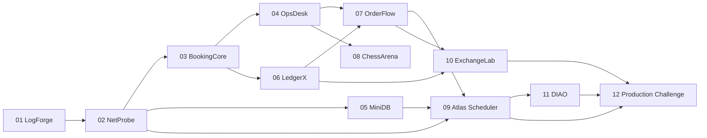

# Project dependencies

Projects are not merely a ladder of technologies. Their business domains are intentionally different, while engineering skills accumulate.

## Why this order

- **01–02:** resources, errors and goroutines.
- **03:** local transactions and invariants as a baseline for later distributed operations.
- **04:** full application, tenant security and delivery processes.
- **05–06:** durability internals and rigorous data modeling.
- **07:** distributed business effects and consistency boundaries.
- **08:** real-time state and clocks; can run alongside 07.
- **09:** partial failures, leases and fencing.
- **10:** complex domains and asynchronous events; builds on 06–07.
- **11:** control planes, agents, rollouts and security integration.
- **12:** operational examination of existing code, not a new greenfield project.

## Shortcuts to avoid

Do not begin 09 if you cannot explain the transaction boundary in 03 and the outbox in 07. Do not build the portfolio ledger in 10 before practicing double-entry bookkeeping in 06.
