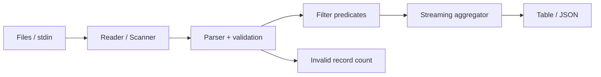

# Architecture — LogForge — streaming log analyzer

> **Status:** proposed design for a learning project, NOT a description of existing code. After gate G2, update this document to reflect actual decisions rather than treating the initial proposal as immutable.
>
> Project **01/12** · estimated effort: **20–30 hours** · stack: **Go standard library; use pprof and benchmarks after correctness**.

## 1. Context, goals and scope

**Goal:** Build a CLI that analyzes very large log files in multiple formats without loading entire files into memory.

**Scope:** **MVP:** local files, timestamp/status filters, per-host/status aggregates, JSON and table output. **Out of scope:** network ingestion, Elasticsearch, GUI, distributed processing.

### Skills developed

Accurate problem modeling, verifiable implementation, explicit management of constraints and evidence-based engineering decisions. This project's specific technical challenges are described in the following sections.

## 2. Technical context and data flow

**Boundaries:** Start with the smallest viable local architecture. Add processes and network hops only when explicitly justified by the requirements or the lesson objective.

### Components and responsibilities

- `cmd/logforge`: arguments and exit codes; no parsing domain logic.
- `internal/input`: line streaming with a documented maximum record size and policy for oversized lines.
- `internal/parse`: JSONL and one explicitly specified text format; include line numbers in errors.
- `internal/aggregate`: counts, min/max, approximate or exact percentiles *with clearly stated cost*.
- `internal/report`: deterministic ordering by specified grouping keys.

## 3. Domain and data model

`LogRecord{timestamp, source, level, status, latencyMs, message}`. Specify all time units. `ParseError{line, reason}` need not stop processing when `--skip-invalid` is enabled. Aggregations are defined by explicit grouping keys.

For each persistent entity, identify data ownership, source of truth, uniqueness rules, schema versioning and retention. If the MVP does not need a database, **do not add one for architectural decoration**.

## 4. Public contracts and interfaces

CLI: `logforge analyze --input file.log --format jsonl --group-by status --output json`. Support stdin with `--input -`; version the JSON output schema. Do not create an HTTP service.

**Shared contract rules:** Validate inputs at boundaries; expose stable error categories; document retries and idempotency; never leak internal secrets or unauthorized data. Version externally consumed contracts.

## 5. Invariants and correctness conditions

- Count every valid record exactly once.
- Valid records + rejected records = read records, under a documented blank-line policy.
- Memory grows with groups/aggregates, not input file size (except explicitly chosen exact-percentile algorithms).
- Identical input and settings produce identical output.

**Exercise:** encode these invariants as executable tests, database constraints or runtime assertions. Explain which can be guaranteed by a local transaction and which require cross-component coordination or an explicit failure model.

## 6. Concurrency, durability and failure scenarios

- Invalid JSON: line-numbered error; `--strict` exits nonzero.
- Oversized record: bounded allocation and a controlled error.
- Interrupted read or denied permissions: unambiguous failure, never masquerade partial output as complete.
- Invalid timestamps: make UTC and source time-zone assumptions explicit.

**Assumptions to validate explicitly:** whether failures are process-level or machine-level, trust in clocks, event ordering, duplicates, retry semantics and transaction boundaries. Do not assume synchronous networks or infallible dependencies.

## 7. Testing and measurement strategy

- Golden tests for supported formats and empty input; compare aggregates against an independent reference implementation on small fixtures.
- Fuzz parsing for panics; property tests for record accounting and commutative aggregation.
- Benchmark 1 MB / 100 MB / 1 GB: `ns/op`, `allocs/op`, peak RSS.
- Process a generated 1 GB log and monitor memory; never use `io.ReadAll` on the whole file.

Verification pyramid: fast unit tests → integration tests against real dependencies → model/property/fuzz tests where useful → fault injection and end-to-end scenarios. Keep *evidence* in `evidence/` or CI reports. Check LLM-proposed tests against requirements independently of the implementation.

## 8. Operations and security

- Emit structured logs, correlation IDs and actionable error context; exclude secrets and private data.
- For services, separate liveness (`/health/live`) from readiness (`/health/ready`) and avoid misleading health checks.
- Specify at least two useful service-level indicators where relevant (e.g., error rate, p95 latency, inconsistent states); do not promise SLOs without evidence.
- Enforce least privilege, external secret configuration, input-size limits and execution deadlines.
- Define backup and recovery procedures wherever persistent state exists; for a CLI, reproducibility and deterministic inputs may matter more.

## 9. Implementation plan — small, controlled increments

1. Deterministic parser for one format.
2. Streaming pipeline and filters.
3. Reports, error handling and resource limits.
4. Benchmarks, profiling and measurement-driven optimization.

After every increment: deliver a demonstration, test evidence, a trade-off list and a brief review with an LLM acting as a skeptical reviewer. Record a short ADR before adding a major dependency or infrastructure component.

## 10. Architecture decisions to defend

- Enlarged `bufio.Scanner` buffer or `bufio.Reader` with custom line-size policy?
- Exact percentiles requiring retained data or approximate percentiles with a documented error bound?
- Deterministic result sorting versus memory proportional to grouping cardinality?

For every decision, explain the context, at least two alternatives, rationale, operating costs, effect on the domain and how the choice could be reversed (see [`../../docs/ADR_TEMPLATE.md`](../../docs/ADR_TEMPLATE.md)).

## 11. Completion criteria and assessment

Stream 1 GB without materializing input; accounting totals match; malformed lines yield controlled behavior; elapsed time and peak memory can be reproduced on documented hardware.

**Additional requirement:** explain *what would fail if a safety mechanism were removed* (constraint, idempotency, fencing, event replay, etc.). Assessment uses [`../../docs/ASSESSMENT.md`](../../docs/ASSESSMENT.md): at least 20/24 overall and at least 3/4 in every dimension, supported by evidence.

## 12. Anti-patterns to identify in review

- Selecting a fashionable technology stack before identifying constraints and invariants.
- Circular tests that compare the implementation with itself.
- Hiding retries, duplicates and exceptions behind logging without resolving correctness.
- Undocumented assumptions that “this cannot happen in production.”
- Huge, unreviewable pull requests generated in one prompt.

**Related documents:** [`README.md`](README.md), [`AGENTS.md`](AGENTS.md), [`../../AGENTS.md`](../../AGENTS.md), [Skill index](../../.agents/skills/SKILLS.md).
