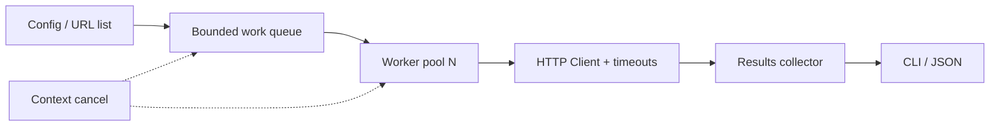

# Architecture — NetProbe — concurrent HTTP monitor

> **Status:** proposed design for a learning project, NOT a description of existing code. After gate G2, update this document to reflect actual decisions rather than treating the initial proposal as immutable.
>
> Project **02/12** · estimated effort: **30–45 hours** · stack: **Go net/http, context, go test -race; no external scheduler**.

## 1. Context, goals and scope

**Goal:** Probe hundreds or thousands of URLs with explicit concurrency limits, timeouts, cancellation and reporting.

**Scope:** **MVP:** one batch from JSON configuration, status and response time. **Extension:** polling, histograms, graceful shutdown. **Out of scope:** Kubernetes, persistent distributed queues.

### Skills developed

Accurate problem modeling, verifiable implementation, explicit management of constraints and evidence-based engineering decisions. This project's specific technical challenges are described in the following sections.

## 2. Technical context and data flow

**Boundaries:** Start with the smallest viable local architecture. Add processes and network hops only when explicitly justified by the requirements or the lesson objective.

### Components and responsibilities

- `config`: validate URLs, concurrency limits and polling intervals.
- `scheduler`: bounded queue and worker pool; leak-free shutdown.
- `probe`: shared `http.Client` transport, timeouts and status classification.
- `results`: histograms/percentiles and failure statistics with bounded result backpressure.
- `app`: process lifecycle and operating-system signal handling.

## 3. Domain and data model

`Target{ID, URL, ExpectedStatus?, Timeout}`; `ProbeResult{targetID, startedAt, duration, statusCode?, errorClass?}`; `Run{runID, startedAt, finishedAt, cancelled}`. Measure durations using a monotonic clock within the process.

For each persistent entity, identify data ownership, source of truth, uniqueness rules, schema versioning and retention. If the MVP does not need a database, **do not add one for architectural decoration**.

## 4. Public contracts and interfaces

`netprobe check --config targets.json --concurrency 20 --timeout 3s --json`. Optional `netprobe watch --interval 30s`. Specify JSONL output and stable error classes.

**Shared contract rules:** Validate inputs at boundaries; expose stable error categories; document retries and idempotency; never leak internal secrets or unauthorized data. Version externally consumed contracts.

## 5. Invariants and correctness conditions

- In-flight requests never exceed the configured concurrency limit.
- Each target receives one outcome per run, or an explicit `cancelled` outcome.
- Every worker observes cancellation and no work goroutines survive after a run completes.
- HTTP 500 is an application response, not a transport error; classification is explicit.

**Exercise:** encode these invariants as executable tests, database constraints or runtime assertions. Explain which can be guaranteed by a local transaction and which require cross-component coordination or an explicit failure model.

## 6. Concurrency, durability and failure scenarios

- Hanging endpoint: enforce a deadline and close the response body.
- DNS failures, TLS failures and HTTP 503 are different categories.
- SIGINT: stop scheduling, cancel work and label the partial report as partial.
- Slow result consumer: enforce queue and memory limits with a documented policy.

**Assumptions to validate explicitly:** whether failures are process-level or machine-level, trust in clocks, event ordering, duplicates, retry semantics and transaction boundaries. Do not assume synchronous networks or infallible dependencies.

## 7. Testing and measurement strategy

- Local `httptest.Server` fixtures for timeouts, HTTP 500, slow bodies and redirects.
- Assert max in-flight <= N using an atomic counter; test cancellation and `go test -race ./...`.
- Run 1,000 local targets with concurrency=20.
- Compare goroutine counts around a run without assuming a fixed Go runtime baseline.

Verification pyramid: fast unit tests → integration tests against real dependencies → model/property/fuzz tests where useful → fault injection and end-to-end scenarios. Keep *evidence* in `evidence/` or CI reports. Check LLM-proposed tests against requirements independently of the implementation.

## 8. Operations and security

- Emit structured logs, correlation IDs and actionable error context; exclude secrets and private data.
- For services, separate liveness (`/health/live`) from readiness (`/health/ready`) and avoid misleading health checks.
- Specify at least two useful service-level indicators where relevant (e.g., error rate, p95 latency, inconsistent states); do not promise SLOs without evidence.
- Enforce least privilege, external secret configuration, input-size limits and execution deadlines.
- Define backup and recovery procedures wherever persistent state exists; for a CLI, reproducibility and deterministic inputs may matter more.

## 9. Implementation plan — small, controlled increments

1. Correct sequential probe and outcome classification.
2. Bounded worker pool and work queue.
3. Cancellation, timeouts and graceful shutdown.
4. Race detection, load tests and measured limits.

After every increment: deliver a demonstration, test evidence, a trade-off list and a brief review with an LLM acting as a skeptical reviewer. Record a short ADR before adding a major dependency or infrastructure component.

## 10. Architecture decisions to defend

- Channels or semaphores? Explain the complexity trade-off.
- Shared timeout policy or per-target timeout?
- Differentiate the whole-run deadline from an individual request deadline.

For every decision, explain the context, at least two alternatives, rationale, operating costs, effect on the domain and how the choice could be reversed (see [`../../docs/ADR_TEMPLATE.md`](../../docs/ADR_TEMPLATE.md)).

## 11. Completion criteria and assessment

Complete 1,000 local target checks with a 20-request limit; cancel without deadlocks; race tests pass; results distinguish all required error categories.

**Additional requirement:** explain *what would fail if a safety mechanism were removed* (constraint, idempotency, fencing, event replay, etc.). Assessment uses [`../../docs/ASSESSMENT.md`](../../docs/ASSESSMENT.md): at least 20/24 overall and at least 3/4 in every dimension, supported by evidence.

## 12. Anti-patterns to identify in review

- Selecting a fashionable technology stack before identifying constraints and invariants.
- Circular tests that compare the implementation with itself.
- Hiding retries, duplicates and exceptions behind logging without resolving correctness.
- Undocumented assumptions that “this cannot happen in production.”
- Huge, unreviewable pull requests generated in one prompt.

**Related documents:** [`README.md`](README.md), [`AGENTS.md`](AGENTS.md), [`../../AGENTS.md`](../../AGENTS.md), [Skill index](../../.agents/skills/SKILLS.md).
