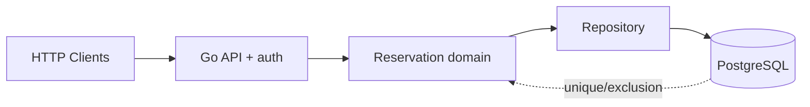

# Architecture — BookingCore — resource reservation system

> **Status:** proposed design for a learning project, NOT a description of existing code. After gate G2, update this document to reflect actual decisions rather than treating the initial proposal as immutable.
>
> Project **03/12** · estimated effort: **45–70 hours** · stack: **Go net/http, PostgreSQL, pgx or database/sql, SQL migrations**.

## 1. Context, goals and scope

**Goal:** Prevent overlapping reservations of one resource under concurrent requests.

**Scope:** **MVP:** users, resources, reservations, cancellation, available slots. **Out of scope:** payments, external calendar integrations, message brokers.

### Skills developed

Accurate problem modeling, verifiable implementation, explicit management of constraints and evidence-based engineering decisions. This project's specific technical challenges are described in the following sections.

## 2. Technical context and data flow

**Boundaries:** Start with the smallest viable local architecture. Add processes and network hops only when explicitly justified by the requirements or the lesson objective.

### Components and responsibilities

- API: validate payloads, authorize operations, return documented HTTP statuses.
- Domain: half-open time intervals `[start,end)` and cancellation policies.
- Repository: transactions and queries with the right isolation level.
- Database: enforce constraints independently of the number of API instances.

## 3. Domain and data model

`Resource{ID, ownerOrgID, name}`; `Reservation{ID, resourceID, userID, startUTC, endUTC, status, version}`; `confirmed|cancelled`. Only `confirmed` holds capacity in the MVP.

For each persistent entity, identify data ownership, source of truth, uniqueness rules, schema versioning and retention. If the MVP does not need a database, **do not add one for architectural decoration**.

## 4. Public contracts and interfaces

`POST /reservations`, `GET /resources/{id}/availability?from=&to=`, `DELETE /reservations/{id}` (logical cancellation), `GET /reservations/{id}`. Use `409 Conflict` on collision; optionally require an `Idempotency-Key` later.

**Shared contract rules:** Validate inputs at boundaries; expose stable error categories; document retries and idempotency; never leak internal secrets or unauthorized data. Version externally consumed contracts.

## 5. Invariants and correctness conditions

- `start < end`; store timestamps in UTC; the user's time zone belongs in the presentation layer.
- Two active reservations of the same resource cannot overlap.
- Cancellation preserves history.
- The database, not just an application-side `if` before `INSERT`, prevents conflicts.
- No user may modify another user's reservation without authorization.

**Exercise:** encode these invariants as executable tests, database constraints or runtime assertions. Explain which can be guaranteed by a local transaction and which require cross-component coordination or an explicit failure model.

## 6. Concurrency, durability and failure scenarios

- Availability race: a PostgreSQL exclusion constraint using `btree_gist` and `tstzrange`, or justified transaction locking.
- Roll back on errors; retry only justified transient failures with bounded attempts.
- Client loses response after COMMIT: idempotent retry or re-read, never blindly insert again.
- Unavailable database: respond with `503`, never a false success.

**Assumptions to validate explicitly:** whether failures are process-level or machine-level, trust in clocks, event ordering, duplicates, retry semantics and transaction boundaries. Do not assume synchronous networks or infallible dependencies.

## 7. Testing and measurement strategy

- Integration tests against real PostgreSQL rather than mocks alone.
- 100 concurrent clients reserve the same slot; exactly one reservation ends `confirmed`.
- Half-open boundary: reservation B may start when A ends.
- Time-zone/DST tests and negative authorization tests.

Verification pyramid: fast unit tests → integration tests against real dependencies → model/property/fuzz tests where useful → fault injection and end-to-end scenarios. Keep *evidence* in `evidence/` or CI reports. Check LLM-proposed tests against requirements independently of the implementation.

## 8. Operations and security

- Emit structured logs, correlation IDs and actionable error context; exclude secrets and private data.
- For services, separate liveness (`/health/live`) from readiness (`/health/ready`) and avoid misleading health checks.
- Specify at least two useful service-level indicators where relevant (e.g., error rate, p95 latency, inconsistent states); do not promise SLOs without evidence.
- Enforce least privilege, external secret configuration, input-size limits and execution deadlines.
- Define backup and recovery procedures wherever persistent state exists; for a CLI, reproducibility and deterministic inputs may matter more.

## 9. Implementation plan — small, controlled increments

1. Domain model and interval tests.
2. SQL conflict constraint and migrations.
3. API, authorization and error contracts.
4. Concurrency tests, idempotency and documentation.

After every increment: deliver a demonstration, test evidence, a trade-off list and a brief review with an LLM acting as a skeptical reviewer. Record a short ADR before adding a major dependency or infrastructure component.

## 10. Architecture decisions to defend

- Exclusion constraint versus serializable transactions / locking.
- Mandatory `Idempotency-Key` immediately or after the basic MVP?
- Maximum reservation length and administrator privileges.

For every decision, explain the context, at least two alternatives, rationale, operating costs, effect on the domain and how the choice could be reversed (see [`../../docs/ADR_TEMPLATE.md`](../../docs/ADR_TEMPLATE.md)).

## 11. Completion criteria and assessment

Exactly one confirmed booking under 100 simultaneous attempts; no unauthorized changes; migrations rebuild the database from scratch.

**Additional requirement:** explain *what would fail if a safety mechanism were removed* (constraint, idempotency, fencing, event replay, etc.). Assessment uses [`../../docs/ASSESSMENT.md`](../../docs/ASSESSMENT.md): at least 20/24 overall and at least 3/4 in every dimension, supported by evidence.

## 12. Anti-patterns to identify in review

- Selecting a fashionable technology stack before identifying constraints and invariants.
- Circular tests that compare the implementation with itself.
- Hiding retries, duplicates and exceptions behind logging without resolving correctness.
- Undocumented assumptions that “this cannot happen in production.”
- Huge, unreviewable pull requests generated in one prompt.

**Related documents:** [`README.md`](README.md), [`AGENTS.md`](AGENTS.md), [`../../AGENTS.md`](../../AGENTS.md), [Skill index](../../.agents/skills/SKILLS.md).
