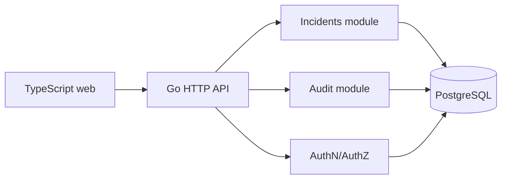

# Architecture — OpsDesk — multi-tenant incident-management SaaS

> **Status:** proposed design for a learning project, NOT a description of existing code. After gate G2, update this document to reflect actual decisions rather than treating the initial proposal as immutable.
>
> Project **04/12** · estimated effort: **60–90 hours** · stack: **Go backend, TypeScript + SvelteKit/React, PostgreSQL, Docker Compose, CI**.

## 1. Context, goals and scope

**Goal:** Build a modular, multi-tenant incident-management application with a usable web UI.

**Scope:** **MVP:** organizations, users, roles, incidents, comments, statuses, audit history and dashboard. **Out of scope:** billing, SSO, microservices, full ITSM.

### Skills developed

Accurate problem modeling, verifiable implementation, explicit management of constraints and evidence-based engineering decisions. This project's specific technical challenges are described in the following sections.

## 2. Technical context and data flow

**Boundaries:** Start with the smallest viable local architecture. Add processes and network hops only when explicitly justified by the requirements or the lesson objective.

### Components and responsibilities

- `identity`: users, sessions/tokens, organization membership and roles.
- `incidents`: workflows `open -> investigating -> resolved -> closed` with explicitly allowed transitions back.
- `audit`: append-only change history (who, what, when).
- `web`: incident list, detail views, forms and dashboard; never enforce access solely in the browser.
- `delivery`: CI, migrations, container packaging and health endpoints.

## 3. Domain and data model

`Organization`, `User`, `Membership{orgID,userID,role}`, `Incident{orgID,assigneeID,status,severity,version}`, `Comment`, `AuditEvent`. Every tenant-owned table carries `org_id` and all authorized accesses are tenant-scoped.

For each persistent entity, identify data ownership, source of truth, uniqueness rules, schema versioning and retention. If the MVP does not need a database, **do not add one for architectural decoration**.

## 4. Public contracts and interfaces

REST `/api/v1/incidents`, `/api/v1/incidents/{id}`, `/api/v1/incidents/{id}/comments`, `/api/v1/me`; pagination and a stable error shape. `/health/live` and `/health/ready` must not expose secrets.

**Shared contract rules:** Validate inputs at boundaries; expose stable error categories; document retries and idempotency; never leak internal secrets or unauthorized data. Version externally consumed contracts.

## 5. Invariants and correctness conditions

- Tenant A cannot read or change tenant B's records, including through crafted API requests.
- Each incident status change records actor, timestamp, old state and new state.
- Role and state-transition rules are enforced by the API, not only the UI.
- Version checks prevent silent overwrites from concurrent edits.

**Exercise:** encode these invariants as executable tests, database constraints or runtime assertions. Explain which can be guaranteed by a local transaction and which require cross-component coordination or an explicit failure model.

## 6. Concurrency, durability and failure scenarios

- Test IDOR and missing tenant filters through negative authorization cases.
- Database outage: readiness fails; liveness should not depend on deep downstream checks.
- Unsafe migration: use expand/migrate/contract with a rollback plan.
- Sessions/tokens expire correctly, cookies have appropriate protections, secrets never reach logs.

**Assumptions to validate explicitly:** whether failures are process-level or machine-level, trust in clocks, event ordering, duplicates, retry semantics and transaction boundaries. Do not assume synchronous networks or infallible dependencies.

## 7. Testing and measurement strategy

- Unit tests for workflows, PostgreSQL integration tests, browser E2E for principal journeys.
- Test a `role × action × tenant` permission matrix including denial paths.
- Run migrations against empty and already populated databases.
- CI formats, tests and builds backend/frontend; add dependency scanning when feasible.

Verification pyramid: fast unit tests → integration tests against real dependencies → model/property/fuzz tests where useful → fault injection and end-to-end scenarios. Keep *evidence* in `evidence/` or CI reports. Check LLM-proposed tests against requirements independently of the implementation.

## 8. Operations and security

- Emit structured logs, correlation IDs and actionable error context; exclude secrets and private data.
- For services, separate liveness (`/health/live`) from readiness (`/health/ready`) and avoid misleading health checks.
- Specify at least two useful service-level indicators where relevant (e.g., error rate, p95 latency, inconsistent states); do not promise SLOs without evidence.
- Enforce least privilege, external secret configuration, input-size limits and execution deadlines.
- Define backup and recovery procedures wherever persistent state exists; for a CLI, reproducibility and deterministic inputs may matter more.

## 9. Implementation plan — small, controlled increments

1. Tenant model and API before frontend complexity.
2. Workflow and auditing.
3. UI and end-to-end authorization.
4. E2E, CI, deployment and migration plan.

After every increment: deliver a demonstration, test evidence, a trade-off list and a brief review with an LLM acting as a skeptical reviewer. Record a short ADR before adding a major dependency or infrastructure component.

## 10. Architecture decisions to defend

- Cookie-based sessions or bearer tokens: compare threat models.
- Repository tenant scoping versus PostgreSQL RLS, potentially both.
- Modular monolith versus separate services; default to the monolith.

For every decision, explain the context, at least two alternatives, rationale, operating costs, effect on the domain and how the choice could be reversed (see [`../../docs/ADR_TEMPLATE.md`](../../docs/ADR_TEMPLATE.md)).

## 11. Completion criteria and assessment

Two organizations are entirely isolated; reproducible deployment from scratch; CI passes; incident status changes can be reconstructed from audit history.

**Additional requirement:** explain *what would fail if a safety mechanism were removed* (constraint, idempotency, fencing, event replay, etc.). Assessment uses [`../../docs/ASSESSMENT.md`](../../docs/ASSESSMENT.md): at least 20/24 overall and at least 3/4 in every dimension, supported by evidence.

## 12. Anti-patterns to identify in review

- Selecting a fashionable technology stack before identifying constraints and invariants.
- Circular tests that compare the implementation with itself.
- Hiding retries, duplicates and exceptions behind logging without resolving correctness.
- Undocumented assumptions that “this cannot happen in production.”
- Huge, unreviewable pull requests generated in one prompt.

**Related documents:** [`README.md`](README.md), [`AGENTS.md`](AGENTS.md), [`../../AGENTS.md`](../../AGENTS.md), [Skill index](../../.agents/skills/SKILLS.md).
