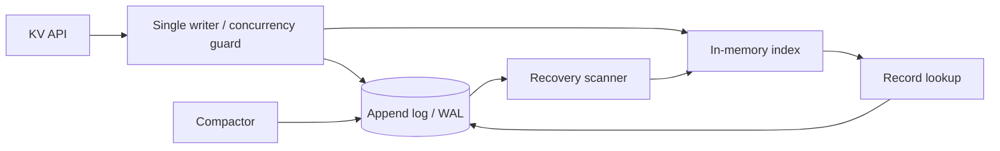

# Architecture — MiniDB — durable key-value storage engine

> **Status:** proposed design for a learning project, NOT a description of existing code. After gate G2, update this document to reflect actual decisions rather than treating the initial proposal as immutable.
>
> Project **05/12** · estimated effort: **70–120 hours** · stack: **Go os/io, binary record format, checksums, pprof**.

## 1. Context, goals and scope

**Goal:** Understand storage engines by building a durable KV store, not a production replacement for RocksDB.

**Scope:** **MVP:** `Put/Get/Delete`, one process, append-only log and in-memory index. **Then:** WAL/snapshots, compaction, recovery. **Out of scope:** clustering, Raft, SQL.

### Skills developed

Accurate problem modeling, verifiable implementation, explicit management of constraints and evidence-based engineering decisions. This project's specific technical challenges are described in the following sections.

## 2. Technical context and data flow

**Boundaries:** Start with the smallest viable local architecture. Add processes and network hops only when explicitly justified by the requirements or the lesson objective.

### Components and responsibilities

- `storage/record`: versioned binary records with lengths, opcodes and CRC.
- `storage/log`: append writes with an explicit `fsync` durability policy; do not fake durability.
- `index`: key-to-offset map that can be rebuilt from the log.
- `recovery`: scan records and detect an incomplete tail.
- `compaction`: new file, atomic replacement and directory synchronization where supported; crash cleanup.

## 3. Domain and data model

`Record{version, op, keyLength, valueLength, key, value, checksum}`. Deletes create tombstones. The MVP permits one active database instance per directory. Specify key/value size limits.

For each persistent entity, identify data ownership, source of truth, uniqueness rules, schema versioning and retention. If the MVP does not need a database, **do not add one for architectural decoration**.

## 4. Public contracts and interfaces

Library API: `Open(path)`, `Put(ctx,key,value)`, `Get(ctx,key)`, `Delete(ctx,key)`, `Close()`. Add a separate diagnostic CLI `minidb inspect`; do not start with an HTTP API.

**Shared contract rules:** Validate inputs at boundaries; expose stable error categories; document retries and idempotency; never leak internal secrets or unauthorized data. Version externally consumed contracts.

## 5. Invariants and correctness conditions

- With the documented durability policy and successful `fsync`, an acknowledged `Put` survives process crash; state hardware/filesystem limits separately.
- The append log is authoritative; indexes are rebuildable.
- Deleted keys never reappear after restart or compaction.
- Operations on each key have a defined order; reject two simultaneous writers against one directory.

**Exercise:** encode these invariants as executable tests, database constraints or runtime assertions. Explain which can be guaranteed by a local transaction and which require cross-component coordination or an explicit failure model.

## 6. Concurrency, durability and failure scenarios

- Crash mid-record: ignore/truncate only an unacknowledged tail after verifying CRC.
- Crash during compaction: select a complete old or new manifest, without losing acknowledged data.
- Disk full (`ENOSPC`): fail visibly, detect partial writes and never acknowledge success.
- Corruption in the middle of the log: report corruption rather than silently rewriting history.

**Assumptions to validate explicitly:** whether failures are process-level or machine-level, trust in clocks, event ordering, duplicates, retry semantics and transaction boundaries. Do not assume synchronous networks or infallible dependencies.

## 7. Testing and measurement strategy

- Property-test sequences against a reference `map[string][]byte`.
- Fuzz record decoding and recovery paths.
- Inject process crashes at selected checkpoints, restart and compare state with the reference model.
- Benchmark `Put/Get`, p50/p99 latency, index RAM and large values.
- Explicitly distinguish process-crash tests from actual power-loss guarantees.

Verification pyramid: fast unit tests → integration tests against real dependencies → model/property/fuzz tests where useful → fault injection and end-to-end scenarios. Keep *evidence* in `evidence/` or CI reports. Check LLM-proposed tests against requirements independently of the implementation.

## 8. Operations and security

- Emit structured logs, correlation IDs and actionable error context; exclude secrets and private data.
- For services, separate liveness (`/health/live`) from readiness (`/health/ready`) and avoid misleading health checks.
- Specify at least two useful service-level indicators where relevant (e.g., error rate, p95 latency, inconsistent states); do not promise SLOs without evidence.
- Enforce least privilege, external secret configuration, input-size limits and execution deadlines.
- Define backup and recovery procedures wherever persistent state exists; for a CLI, reproducibility and deterministic inputs may matter more.

## 9. Implementation plan — small, controlled increments

1. Record format and single-writer discipline.
2. Append log and index.
3. Recovery and injected crashes.
4. Compaction, atomic switching and measurements.

After every increment: deliver a demonstration, test evidence, a trade-off list and a brief review with an LLM acting as a skeptical reviewer. Record a short ADR before adding a major dependency or infrastructure component.

## 10. Architecture decisions to defend

- Sync each `Put`, batch `fsync`, or offer explicit durability levels?
- Mutable in-memory index versus basic segmented index.
- Directory locking and multiple-instance hazards.

For every decision, explain the context, at least two alternatives, rationale, operating costs, effect on the domain and how the choice could be reversed (see [`../../docs/ADR_TEMPLATE.md`](../../docs/ADR_TEMPLATE.md)).

## 11. Completion criteria and assessment

Correct recovery after crashes during writes/compaction; acknowledged records remain durable under the selected process-crash model; independent reference-model verification.

**Additional requirement:** explain *what would fail if a safety mechanism were removed* (constraint, idempotency, fencing, event replay, etc.). Assessment uses [`../../docs/ASSESSMENT.md`](../../docs/ASSESSMENT.md): at least 20/24 overall and at least 3/4 in every dimension, supported by evidence.

## 12. Anti-patterns to identify in review

- Selecting a fashionable technology stack before identifying constraints and invariants.
- Circular tests that compare the implementation with itself.
- Hiding retries, duplicates and exceptions behind logging without resolving correctness.
- Undocumented assumptions that “this cannot happen in production.”
- Huge, unreviewable pull requests generated in one prompt.

**Related documents:** [`README.md`](README.md), [`AGENTS.md`](AGENTS.md), [`../../AGENTS.md`](../../AGENTS.md), [Skill index](../../.agents/skills/SKILLS.md).
