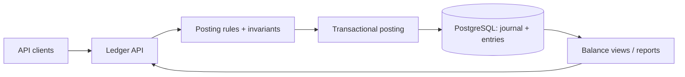

# Architecture — LedgerX — double-entry financial ledger

> **Status:** proposed design for a learning project, NOT a description of existing code. After gate G2, update this document to reflect actual decisions rather than treating the initial proposal as immutable.
>
> Project **06/12** · estimated effort: **80–130 hours** · stack: **Go, PostgreSQL, SQL migrations and transactions**.

## 1. Context, goals and scope

**Goal:** Build an auditable, balanced ledger and then introduce holds and reversals.

**Scope:** **MVP:** accounts, journal entries, transfers, balance reports, reversals. **Extension:** holds and available funds. **Out of scope:** real payments, FX, banking compliance.

### Skills developed

Accurate problem modeling, verifiable implementation, explicit management of constraints and evidence-based engineering decisions. This project's specific technical challenges are described in the following sections.

## 2. Technical context and data flow

**Boundaries:** Start with the smallest viable local architecture. Add processes and network hops only when explicitly justified by the requirements or the lesson objective.

### Components and responsibilities

- `accounts`: accounts and currency configuration.
- `posting`: verify balance before writing, idempotency keys and transactions.
- `journal`: immutable posting groups; reverse by recording new postings.
- `balances`: compute from entries or maintain a transactionally updated cache with consistency checks.
- `reporting`: history, statements and correlated audits.

## 3. Domain and data model

`Account{id,currency,status}`; `JournalEntry{id,externalRef,createdAt,type}`; `Posting{entryID,accountID,currency,amountMinorSigned}`; `IdempotencyRecord{scope,key,resultHash}`; optional `Hold`. Money is represented by **integers in the currency's minor units**, never floats.

For each persistent entity, identify data ownership, source of truth, uniqueness rules, schema versioning and retention. If the MVP does not need a database, **do not add one for architectural decoration**.

## 4. Public contracts and interfaces

`POST /v1/transfers` with `Idempotency-Key`; `GET /v1/accounts/{id}/balance`; `GET /v1/journal/{entryID}`; `POST /v1/journal/{entryID}/reverse`. Distinguish conflicting retries from insufficient funds.

**Shared contract rules:** Validate inputs at boundaries; expose stable error categories; document retries and idempotency; never leak internal secrets or unauthorized data. Version externally consumed contracts.

## 5. Invariants and correctness conditions

- Each committed journal entry sums to **zero in each currency**.
- Journal entries are immutable; corrections are new, linked operations.
- One `Idempotency-Key` in a scope identifies one operation; a different payload under that key is a conflict.
- Disallowed negative balances are prevented transactionally even under concurrency.
- Both sides of a transfer are written in one database transaction, never partially.

**Exercise:** encode these invariants as executable tests, database constraints or runtime assertions. Explain which can be guaranteed by a local transaction and which require cross-component coordination or an explicit failure model.

## 6. Concurrency, durability and failure scenarios

- Response lost after COMMIT: retry returns the original result.
- 100 concurrent debits: lock accounts in stable order and use suitable isolation.
- Wrong posting: reverse it; never `UPDATE posting`.
- Integer overflow and invalid currency scaling: reject before write.

**Assumptions to validate explicitly:** whether failures are process-level or machine-level, trust in clocks, event ordering, duplicates, retry semantics and transaction boundaries. Do not assume synchronous networks or infallible dependencies.

## 7. Testing and measurement strategy

- Property-test per-currency zero sums after every successful scenario.
- Concurrent PostgreSQL transfer tests including retries, timeouts and idempotency.
- Reconcile derived balances with cached balances if a cache is used.
- Generate random transfer/reversal sequences and independently audit the outcomes.

Verification pyramid: fast unit tests → integration tests against real dependencies → model/property/fuzz tests where useful → fault injection and end-to-end scenarios. Keep *evidence* in `evidence/` or CI reports. Check LLM-proposed tests against requirements independently of the implementation.

## 8. Operations and security

- Emit structured logs, correlation IDs and actionable error context; exclude secrets and private data.
- For services, separate liveness (`/health/live`) from readiness (`/health/ready`) and avoid misleading health checks.
- Specify at least two useful service-level indicators where relevant (e.g., error rate, p95 latency, inconsistent states); do not promise SLOs without evidence.
- Enforce least privilege, external secret configuration, input-size limits and execution deadlines.
- Define backup and recovery procedures wherever persistent state exists; for a CLI, reproducibility and deterministic inputs may matter more.

## 9. Implementation plan — small, controlled increments

1. Amount, account and posting model.
2. Transactional transfers and balances.
3. Idempotency and reversal.
4. Concurrency, holds, auditing and independent tests.

After every increment: deliver a demonstration, test evidence, a trade-off list and a brief review with an LLM acting as a skeptical reviewer. Record a short ADR before adding a major dependency or infrastructure component.

## 10. Architecture decisions to defend

- Compute balances on demand or transactionally materialize them?
- Which transaction isolation and consistent account locking order?
- Model overdraft limits and holds without breaking the audit trail.

For every decision, explain the context, at least two alternatives, rationale, operating costs, effect on the domain and how the choice could be reversed (see [`../../docs/ADR_TEMPLATE.md`](../../docs/ADR_TEMPLATE.md)).

## 11. Completion criteria and assessment

Random and concurrent transfers never break double-entry balance; retries never double-post; every balance is auditable; use simulated money only.

**Additional requirement:** explain *what would fail if a safety mechanism were removed* (constraint, idempotency, fencing, event replay, etc.). Assessment uses [`../../docs/ASSESSMENT.md`](../../docs/ASSESSMENT.md): at least 20/24 overall and at least 3/4 in every dimension, supported by evidence.

## 12. Anti-patterns to identify in review

- Selecting a fashionable technology stack before identifying constraints and invariants.
- Circular tests that compare the implementation with itself.
- Hiding retries, duplicates and exceptions behind logging without resolving correctness.
- Undocumented assumptions that “this cannot happen in production.”
- Huge, unreviewable pull requests generated in one prompt.

**Related documents:** [`README.md`](README.md), [`AGENTS.md`](AGENTS.md), [`../../AGENTS.md`](../../AGENTS.md), [Skill index](../../.agents/skills/SKILLS.md).
