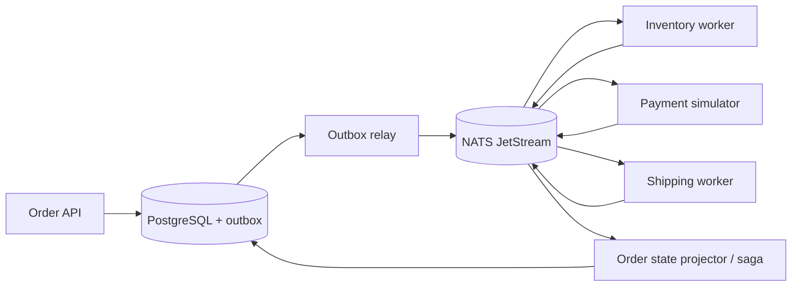

# Architecture — OrderFlow — asynchronous order fulfillment

> **Status:** proposed design for a learning project, NOT a description of existing code. After gate G2, update this document to reflect actual decisions rather than treating the initial proposal as immutable.
>
> Project **07/12** · estimated effort: **90–150 hours** · stack: **Go, PostgreSQL, NATS JetStream (or RabbitMQ after an ADR), OpenTelemetry**.

## 1. Context, goals and scope

**Goal:** Implement a multi-step business workflow where messages may be duplicated and responses may be lost.

**Scope:** **MVP:** orders, inventory reservations, simulated payments, shipping and compensations. **Out of scope:** real payment processors and multi-region deployment.

### Skills developed

Accurate problem modeling, verifiable implementation, explicit management of constraints and evidence-based engineering decisions. This project's specific technical challenges are described in the following sections.

## 2. Technical context and data flow

**Boundaries:** Start with the smallest viable local architecture. Add processes and network hops only when explicitly justified by the requirements or the lesson objective.

### Components and responsibilities

- Order aggregate: acceptance, versioning and status transitions.
- Outbox relay: publish events committed in the same database transaction as state changes.
- Inventory/Payment/Shipping: idempotent consumers that distinguish transient from permanent errors.
- Saga: explicit state machine and compensating actions, not an imaginary global transaction.
- Inbox/deduplication: store processed `event_id` per consumer in the same transaction as the effect.

## 3. Domain and data model

`Order{id,version,status,totalMinor}`; `OrderLine`; `OutboxEvent{id,aggregateID,type,payload,createdAt,publishedAt?}`; `ProcessedEvent{consumer,eventID}`; `Reservation`; `PaymentAttempt`; `Shipment`. Every message has schema version, correlation ID and event ID.

For each persistent entity, identify data ownership, source of truth, uniqueness rules, schema versioning and retention. If the MVP does not need a database, **do not add one for architectural decoration**.

## 4. Public contracts and interfaces

Idempotent `POST /orders`, `GET /orders/{id}`. Versioned, validated events: `OrderCreated`, `InventoryReserved`, `PaymentAuthorized`, `OrderRejected`, `ShipmentCreated`.

**Shared contract rules:** Validate inputs at boundaries; expose stable error categories; document retries and idempotency; never leak internal secrets or unauthorized data. Version externally consumed contracts.

## 5. Invariants and correctness conditions

- An order cannot become `shipped` until both inventory reservation and payment are confirmed.
- A consumer applies the business effect of a given `event_id` at most once despite at-least-once delivery.
- State changes and the related outbox entry are committed together in PostgreSQL.
- Terminal states have consistent effects or documented compensations.
- Do not claim exactly-once external execution without the external system's idempotency support.

**Exercise:** encode these invariants as executable tests, database constraints or runtime assertions. Explain which can be guaranteed by a local transaction and which require cross-component coordination or an explicit failure model.

## 6. Concurrency, durability and failure scenarios

- Crash after COMMIT, before publish: the relay publishes later.
- Crash after publish, before marking sent: redelivery is expected; deduplication works.
- Out-of-order events: validate versions and state; retry or buffer as the contract specifies.
- Payment simulator times out after performing the effect: reconcile by idempotency key, never blindly charge again.
- Poison message: bounded retries, DLQ, alert and manual repair procedure.

**Assumptions to validate explicitly:** whether failures are process-level or machine-level, trust in clocks, event ordering, duplicates, retry semantics and transaction boundaries. Do not assume synchronous networks or infallible dependencies.

## 7. Testing and measurement strategy

- Deterministic replay, duplicate/out-of-order delivery and consumer-restart scenarios.
- PostgreSQL and real broker integration tests, not mocks for everything.
- Kill processes at each critical transaction boundary.
- Independently verify consistency of orders, reservations and payment effects.

Verification pyramid: fast unit tests → integration tests against real dependencies → model/property/fuzz tests where useful → fault injection and end-to-end scenarios. Keep *evidence* in `evidence/` or CI reports. Check LLM-proposed tests against requirements independently of the implementation.

## 8. Operations and security

- Emit structured logs, correlation IDs and actionable error context; exclude secrets and private data.
- For services, separate liveness (`/health/live`) from readiness (`/health/ready`) and avoid misleading health checks.
- Specify at least two useful service-level indicators where relevant (e.g., error rate, p95 latency, inconsistent states); do not promise SLOs without evidence.
- Enforce least privilege, external secret configuration, input-size limits and execution deadlines.
- Define backup and recovery procedures wherever persistent state exists; for a CLI, reproducibility and deterministic inputs may matter more.

## 9. Implementation plan — small, controlled increments

1. Modular monolith and one transaction to establish domain semantics.
2. Outbox/inbox and introduction of a broker.
3. Saga and compensation logic.
4. Chaos tests and operations dashboard.

After every increment: deliver a demonstration, test evidence, a trade-off list and a brief review with an LLM acting as a skeptical reviewer. Record a short ADR before adding a major dependency or infrastructure component.

## 10. Architecture decisions to defend

- Saga orchestration versus choreography.
- Is a broker needed? If so, what delivery guarantee does it provide?
- Consumer boundaries and versioned event schemas.

For every decision, explain the context, at least two alternatives, rationale, operating costs, effect on the domain and how the choice could be reversed (see [`../../docs/ADR_TEMPLATE.md`](../../docs/ADR_TEMPLATE.md)).

## 11. Completion criteria and assessment

Orders converge to consistent outcomes after crashes between COMMIT and publish; duplicates never duplicate business effects; compensations leave no orphan inventory holds.

**Additional requirement:** explain *what would fail if a safety mechanism were removed* (constraint, idempotency, fencing, event replay, etc.). Assessment uses [`../../docs/ASSESSMENT.md`](../../docs/ASSESSMENT.md): at least 20/24 overall and at least 3/4 in every dimension, supported by evidence.

## 12. Anti-patterns to identify in review

- Selecting a fashionable technology stack before identifying constraints and invariants.
- Circular tests that compare the implementation with itself.
- Hiding retries, duplicates and exceptions behind logging without resolving correctness.
- Undocumented assumptions that “this cannot happen in production.”
- Huge, unreviewable pull requests generated in one prompt.

**Related documents:** [`README.md`](README.md), [`AGENTS.md`](AGENTS.md), [`../../AGENTS.md`](../../AGENTS.md), [Skill index](../../.agents/skills/SKILLS.md).
