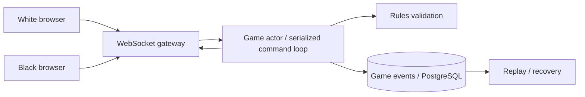

# Architecture — ChessArena — real-time chess platform

> **Status:** proposed design for a learning project, NOT a description of existing code. After gate G2, update this document to reflect actual decisions rather than treating the initial proposal as immutable.
>
> Project **08/12** · estimated effort: **100–160 hours** · stack: **Go, TypeScript, WebSocket, PostgreSQL; existing legal-move library allowed**.

## 1. Context, goals and scope

**Goal:** Preserve authoritative game state and correct command ordering despite network interruptions and clock complexity.

**Scope:** **MVP:** 1v1 games, moves, clocks, PGN, reconnect, rating. **Extensions:** Swiss/round-robin tournaments, matchmaking and analysis. **Out of scope:** building a grandmaster-strength engine.

### Skills developed

Accurate problem modeling, verifiable implementation, explicit management of constraints and evidence-based engineering decisions. This project's specific technical challenges are described in the following sections.

## 2. Technical context and data flow

**Boundaries:** Start with the smallest viable local architecture. Add processes and network hops only when explicitly justified by the requirements or the lesson objective.

### Components and responsibilities

- `game`: board state, legal moves, sides, result and clocks.
- `command`: deduplicate by `command_id`, enforce game versions, serialize commands.
- `transport`: WebSockets and snapshot-plus-delta reconnection.
- `persistence`: append-only accepted events, snapshots and PGN export.
- `tournaments`: separate module only after stable 1v1 gameplay.

## 3. Domain and data model

`Game{id,white,black,status,version,position,clockState}`; `MoveCommand{gameID,commandID,expectedVersion,move}`; `GameEvent{gameID,seq,type,recordedAt,payload}`; `ClockState{remainingWhite,remainingBlack,turnStartedAt}`. The server is authoritative.

For each persistent entity, identify data ownership, source of truth, uniqueness rules, schema versioning and retention. If the MVP does not need a database, **do not add one for architectural decoration**.

## 4. Public contracts and interfaces

`POST /games`, `GET /games/{id}`, `WS /games/{id}/events`; command `Move{command_id,expected_version,uci}`. Return accepted/rejected with a version; clients support reconnect and state resynchronization.

**Shared contract rules:** Validate inputs at boundaries; expose stable error categories; document retries and idempotency; never leak internal secrets or unauthorized data. Version externally consumed contracts.

## 5. Invariants and correctness conditions

- Exactly one side is allowed to move at any given game version.
- Accepted events have monotonically increasing, gap-free per-game sequence numbers.
- Repeating `command_id` never makes a second move.
- Reconnection cannot grant extra clock time; define wall-clock recovery policy explicitly.
- Win/draw outcomes do not depend on browser packet arrival order.

**Exercise:** encode these invariants as executable tests, database constraints or runtime assertions. Explain which can be guaranteed by a local transaction and which require cross-component coordination or an explicit failure model.

## 6. Concurrency, durability and failure scenarios

- Reconnect and repeated moves: snapshots plus replay of missing events.
- Concurrent commands: serialize per game, check expected versions and reject conflicts.
- Crash after persisting accepted event but before emitting it: client receives it on replay.
- Use monotonic time within one process; persist recovery deadlines and specify acceptable jitter.

**Assumptions to validate explicitly:** whether failures are process-level or machine-level, trust in clocks, event ordering, duplicates, retry semantics and transaction boundaries. Do not assume synchronous networks or infallible dependencies.

## 7. Testing and measurement strategy

- State-transition and legal/illegal move tests.
- Property test: event replay reconstructs identical game state.
- Fuzz WebSocket message parsing and test duplicated/reordered commands.
- Two-client E2E with disconnect, server restart and flag-fall boundaries.

Verification pyramid: fast unit tests → integration tests against real dependencies → model/property/fuzz tests where useful → fault injection and end-to-end scenarios. Keep *evidence* in `evidence/` or CI reports. Check LLM-proposed tests against requirements independently of the implementation.

## 8. Operations and security

- Emit structured logs, correlation IDs and actionable error context; exclude secrets and private data.
- For services, separate liveness (`/health/live`) from readiness (`/health/ready`) and avoid misleading health checks.
- Specify at least two useful service-level indicators where relevant (e.g., error rate, p95 latency, inconsistent states); do not promise SLOs without evidence.
- Enforce least privilege, external secret configuration, input-size limits and execution deadlines.
- Define backup and recovery procedures wherever persistent state exists; for a CLI, reproducibility and deterministic inputs may matter more.

## 9. Implementation plan — small, controlled increments

1. Single-player domain, state transitions and clock model.
2. Two clients, WebSocket and event log.
3. Reconnect, replay and idempotency.
4. Tournaments, ratings, load and security review.

After every increment: deliver a demonstration, test evidence, a trade-off list and a brief review with an LLM acting as a skeptical reviewer. Record a short ADR before adding a major dependency or infrastructure component.

## 10. Architecture decisions to defend

- Per-game actor versus database locking across instances.
- Clock synchronization: authoritative server versus unreliable client time.
- Adopt and test a rules library rather than casually reimplementing chess legality.

For every decision, explain the context, at least two alternatives, rationale, operating costs, effect on the domain and how the choice could be reversed (see [`../../docs/ADR_TEMPLATE.md`](../../docs/ADR_TEMPLATE.md)).

## 11. Completion criteria and assessment

Reordering and duplicate messages cannot corrupt game state; both browsers converge on the same state/history after reconnect; replay reconstructs the result.

**Additional requirement:** explain *what would fail if a safety mechanism were removed* (constraint, idempotency, fencing, event replay, etc.). Assessment uses [`../../docs/ASSESSMENT.md`](../../docs/ASSESSMENT.md): at least 20/24 overall and at least 3/4 in every dimension, supported by evidence.

## 12. Anti-patterns to identify in review

- Selecting a fashionable technology stack before identifying constraints and invariants.
- Circular tests that compare the implementation with itself.
- Hiding retries, duplicates and exceptions behind logging without resolving correctness.
- Undocumented assumptions that “this cannot happen in production.”
- Huge, unreviewable pull requests generated in one prompt.

**Related documents:** [`README.md`](README.md), [`AGENTS.md`](AGENTS.md), [`../../AGENTS.md`](../../AGENTS.md), [`../../SKILLS.md`](../../SKILLS.md).
