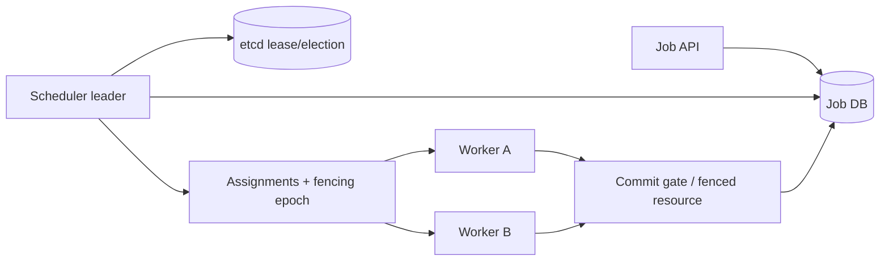

# Architecture — Atlas Scheduler — distributed job scheduler

> **Status:** proposed design for a learning project, NOT a description of existing code. After gate G2, update this document to reflect actual decisions rather than treating the initial proposal as immutable.
>
> Project **09/12** · estimated effort: **130–210 hours** · stack: **Go, gRPC/Protobuf, etcd, PostgreSQL for jobs, OpenTelemetry**.

## 1. Context, goals and scope

**Goal:** Assign and track work safely despite worker failures, leader failures and network partitions.

**Scope:** **MVP:** job registry, worker leases, assignments, bounded retry/backoff, status and cancellation. **Later:** priorities, quotas, scheduling policies. **Out of scope:** general Kubernetes replacement.

### Skills developed

Accurate problem modeling, verifiable implementation, explicit management of constraints and evidence-based engineering decisions. This project's specific technical challenges are described in the following sections.

## 2. Technical context and data flow

**Boundaries:** Start with the smallest viable local architecture. Add processes and network hops only when explicitly justified by the requirements or the lesson objective.

### Components and responsibilities

- `api`: submit, cancel, list; idempotent submissions.
- `scheduler`: etcd leader election; assign work only while leadership is valid.
- `leases`: assignments with epoch/fencing token, expiry and renewal.
- `workers`: heartbeats, pull/claim, execution, progress and cancellable contexts.
- `commit gate`: protected resource that **validates a fencing token** before a durable effect; leases alone do not stop stale workers.
- `recovery`: detect abandoned assignments and retry with limits.

## 3. Domain and data model

`Job{id,kind,payload,status,attempt,version}`; `Assignment{jobID,workerID,leaseID,epoch,deadline}`; `Worker{id,capabilities,lastSeen}`; `ExecutionResult{jobID,attempt,epoch,resultRef}`. Job states: pending, assigned, running, succeeded, failed, cancelled.

For each persistent entity, identify data ownership, source of truth, uniqueness rules, schema versioning and retention. If the MVP does not need a database, **do not add one for architectural decoration**.

## 4. Public contracts and interfaces

gRPC `SubmitJob`, `ClaimWork`, `Heartbeat`, `ReportResult`, `CancelJob`; versioned Protobuf contracts and correlation IDs. Optional admin HTTP API. Distinguish command acceptance from completed work.

**Shared contract rules:** Validate inputs at boundaries; expose stable error categories; document retries and idempotency; never leak internal secrets or unauthorized data. Version externally consumed contracts.

## 5. Invariants and correctness conditions

- Only the currently authorized worker with a valid epoch may commit to a fenced resource.
- Code may execute more than once after failover; results have identifiers and idempotent commits.
- Delayed messages cannot regress `succeeded` to `running`.
- A leader validates its lease rather than assuming leadership remains valid.
- Non-idempotent external effects require an explicit contract; do not promise exactly-once execution.

**Exercise:** encode these invariants as executable tests, database constraints or runtime assertions. Explain which can be guaranteed by a local transaction and which require cross-component coordination or an explicit failure model.

## 6. Concurrency, durability and failure scenarios

- Partition: stale workers may continue computing but cannot commit to fenced resources.
- Leader loss: new leader reconstructs assignments from durable state.
- Worker restart: expired lease may cause retry; deduplicate resulting effects.
- Partially completed external side effect: idempotency or compensation is needed; explain limits.

**Assumptions to validate explicitly:** whether failures are process-level or machine-level, trust in clocks, event ordering, duplicates, retry semantics and transaction boundaries. Do not assume synchronous networks or infallible dependencies.

## 7. Testing and measurement strategy

- Multiprocess tests that kill leaders/workers and inject network faults in an owned lab.
- Deterministic simulated delays and state-transition tests.
- Fencing test: reject a stale worker's result after lease expiry.
- Protobuf old-client/new-server compatibility tests and queue-overload scenarios.

Verification pyramid: fast unit tests → integration tests against real dependencies → model/property/fuzz tests where useful → fault injection and end-to-end scenarios. Keep *evidence* in `evidence/` or CI reports. Check LLM-proposed tests against requirements independently of the implementation.

## 8. Operations and security

- Emit structured logs, correlation IDs and actionable error context; exclude secrets and private data.
- For services, separate liveness (`/health/live`) from readiness (`/health/ready`) and avoid misleading health checks.
- Specify at least two useful service-level indicators where relevant (e.g., error rate, p95 latency, inconsistent states); do not promise SLOs without evidence.
- Enforce least privilege, external secret configuration, input-size limits and execution deadlines.
- Define backup and recovery procedures wherever persistent state exists; for a CLI, reproducibility and deterministic inputs may matter more.

## 9. Implementation plan — small, controlled increments

1. Durable single-node scheduler without etcd.
2. Worker leases, retries and state persistence.
3. Multiple schedulers, etcd election and fencing.
4. Partition drills, quotas and benchmarks.

After every increment: deliver a demonstration, test evidence, a trade-off list and a brief review with an LLM acting as a skeptical reviewer. Record a short ADR before adding a major dependency or infrastructure component.

## 10. Architecture decisions to defend

- etcd election versus PostgreSQL locking: guarantees and operational cost.
- Push versus pull work assignments.
- Exactly-once committed result versus impossible general exactly-once external execution.

For every decision, explain the context, at least two alternatives, rationale, operating costs, effect on the domain and how the choice could be reversed (see [`../../docs/ADR_TEMPLATE.md`](../../docs/ADR_TEMPLATE.md)).

## 11. Completion criteria and assessment

A partitioned stale worker cannot commit; jobs resume after leader death; repeated-execution semantics are documented and validated.

**Additional requirement:** explain *what would fail if a safety mechanism were removed* (constraint, idempotency, fencing, event replay, etc.). Assessment uses [`../../docs/ASSESSMENT.md`](../../docs/ASSESSMENT.md): at least 20/24 overall and at least 3/4 in every dimension, supported by evidence.

## 12. Anti-patterns to identify in review

- Selecting a fashionable technology stack before identifying constraints and invariants.
- Circular tests that compare the implementation with itself.
- Hiding retries, duplicates and exceptions behind logging without resolving correctness.
- Undocumented assumptions that “this cannot happen in production.”
- Huge, unreviewable pull requests generated in one prompt.

**Related documents:** [`README.md`](README.md), [`AGENTS.md`](AGENTS.md), [`../../AGENTS.md`](../../AGENTS.md), [`../../SKILLS.md`](../../SKILLS.md).
