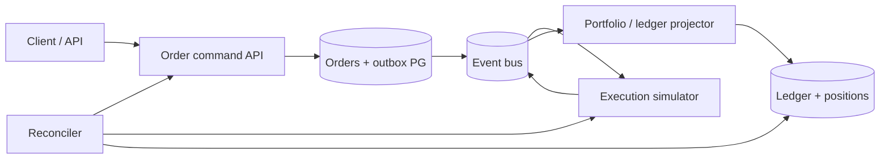

# Architecture — ExchangeLab — simulated-trading order management system

> **Status:** proposed design for a learning project, NOT a description of existing code. After gate G2, update this document to reflect actual decisions rather than treating the initial proposal as immutable.
>
> Project **10/12** · estimated effort: **160–250 hours** · stack: **Go, PostgreSQL, Redis Streams or NATS, optional TypeScript**.

## 1. Context, goals and scope

**Goal:** Implement correct order lifecycles, execution ingestion, risk checks and portfolio bookkeeping in a fully simulated environment.

**Scope:** **MVP:** market/limit orders, simulated broker and fills, portfolio and cash. **Then:** partial fills, cancel/replace, risk, reconciliation, replay. **Out of scope:** live money and regulated exchange connections.

### Skills developed

Accurate problem modeling, verifiable implementation, explicit management of constraints and evidence-based engineering decisions. This project's specific technical challenges are described in the following sections.

## 2. Technical context and data flow

**Boundaries:** Start with the smallest viable local architecture. Add processes and network hops only when explicitly justified by the requirements or the lesson objective.

### Components and responsibilities

- `oms`: validate, accept, reject, cancel, replace; order state machine.
- `risk`: buying power, positions, exposure limits and order reservations.
- `simulated broker/matching`: deterministic fills and controllable test events.
- `execution ingestion`: deduplicate `execution_id`, handle versions and event ordering.
- `portfolio`: cash/position ledger, executions and optional mark-to-market valuation.
- `reconciliation`: compare broker state and local projections; detect differences and repair without blind overwrites.

## 3. Domain and data model

`Order{id,clientOrderID,accountID,symbol,side,type,qty,filledQty,status,version}`; `Execution{executionID,orderID,qty,priceMinor,side,occurredAt}`; `Reservation`; `CashPosting`; `Position`; `ReconcileRun`. Keep raw simulated broker receipts with correlation IDs and justified retention.

For each persistent entity, identify data ownership, source of truth, uniqueness rules, schema versioning and retention. If the MVP does not need a database, **do not add one for architectural decoration**.

## 4. Public contracts and interfaces

`POST /v1/orders` with clientOrderID; `POST /v1/orders/{id}/cancel`; `GET /v1/orders/{id}`; `GET /v1/accounts/{id}/portfolio`; versioned `OrderAccepted`, `FillReceived`, `CancelAccepted`, `OrderRejected` events.

**Shared contract rules:** Validate inputs at boundaries; expose stable error categories; document retries and idempotency; never leak internal secrets or unauthorized data. Version externally consumed contracts.

## 5. Invariants and correctness conditions

- `0 <= filledQty <= qty`; deduplicated fill quantities sum to `filledQty`.
- A repeated `executionID` never posts cash/positions twice.
- Rejection/cancellation does not erase prior fills; handle the fill-versus-cancel race.
- Every journal effect is traceable to one unique accepted execution.
- Risk checks and resource reservation are atomically coordinated under the account model.
- Use **simulated money and data only**.

**Exercise:** encode these invariants as executable tests, database constraints or runtime assertions. Explain which can be guaranteed by a local transaction and which require cross-component coordination or an explicit failure model.

## 6. Concurrency, durability and failure scenarios

- Duplicate, out-of-order or delayed partial-fill events.
- Cancel timeout: `cancel_pending` does not mean the order is already cancelled.
- Crash after persisting an Execution but before updating projections: idempotent replay.
- Broker/portfolio discrepancy: reconciler reports the difference without hiding event history.

**Assumptions to validate explicitly:** whether failures are process-level or machine-level, trust in clocks, event ordering, duplicates, retry semantics and transaction boundaries. Do not assume synchronous networks or infallible dependencies.

## 7. Testing and measurement strategy

- Model-based order state-machine tests and quantity invariants.
- Replay with randomized ordering, duplicates and delays; assert convergence where guaranteed by contract.
- PostgreSQL transaction, outbox and reconciliation integration tests.
- Insufficient cash, partial-fill + cancel, cancel/fill race and restart-after-execution scenarios.

Verification pyramid: fast unit tests → integration tests against real dependencies → model/property/fuzz tests where useful → fault injection and end-to-end scenarios. Keep *evidence* in `evidence/` or CI reports. Check LLM-proposed tests against requirements independently of the implementation.

## 8. Operations and security

- Emit structured logs, correlation IDs and actionable error context; exclude secrets and private data.
- For services, separate liveness (`/health/live`) from readiness (`/health/ready`) and avoid misleading health checks.
- Specify at least two useful service-level indicators where relevant (e.g., error rate, p95 latency, inconsistent states); do not promise SLOs without evidence.
- Enforce least privilege, external secret configuration, input-size limits and execution deadlines.
- Define backup and recovery procedures wherever persistent state exists; for a CLI, reproducibility and deterministic inputs may matter more.

## 9. Implementation plan — small, controlled increments

1. One account, one instrument class and deterministic simulator.
2. Order lifecycle and idempotent executions.
3. Portfolio ledger and cash reservation.
4. Async events and reconciliation.
5. Crash replay and integrity reporting.

After every increment: deliver a demonstration, test evidence, a trade-off list and a brief review with an LLM acting as a skeptical reviewer. Record a short ADR before adding a major dependency or infrastructure component.

## 10. Architecture decisions to defend

- Broker receipts versus local projections as source of truth: when and for what?
- Separate order state and the portfolio ledger.
- Redis Streams versus NATS through a replaceable `ExecutionEvents` port.
- Start with equities; options form a separate domain milestone.

For every decision, explain the context, at least two alternatives, rationale, operating costs, effect on the domain and how the choice could be reversed (see [`../../docs/ADR_TEMPLATE.md`](../../docs/ADR_TEMPLATE.md)).

## 11. Completion criteria and assessment

Duplicate executions do not change outcomes; filled quantity never exceeds order quantity; portfolio ledger reconciles with accepted executions; restart recovery is correct.

**Additional requirement:** explain *what would fail if a safety mechanism were removed* (constraint, idempotency, fencing, event replay, etc.). Assessment uses [`../../docs/ASSESSMENT.md`](../../docs/ASSESSMENT.md): at least 20/24 overall and at least 3/4 in every dimension, supported by evidence.

## 12. Anti-patterns to identify in review

- Selecting a fashionable technology stack before identifying constraints and invariants.
- Circular tests that compare the implementation with itself.
- Hiding retries, duplicates and exceptions behind logging without resolving correctness.
- Undocumented assumptions that “this cannot happen in production.”
- Huge, unreviewable pull requests generated in one prompt.

**Related documents:** [`README.md`](README.md), [`AGENTS.md`](AGENTS.md), [`../../AGENTS.md`](../../AGENTS.md), [`../../SKILLS.md`](../../SKILLS.md).
