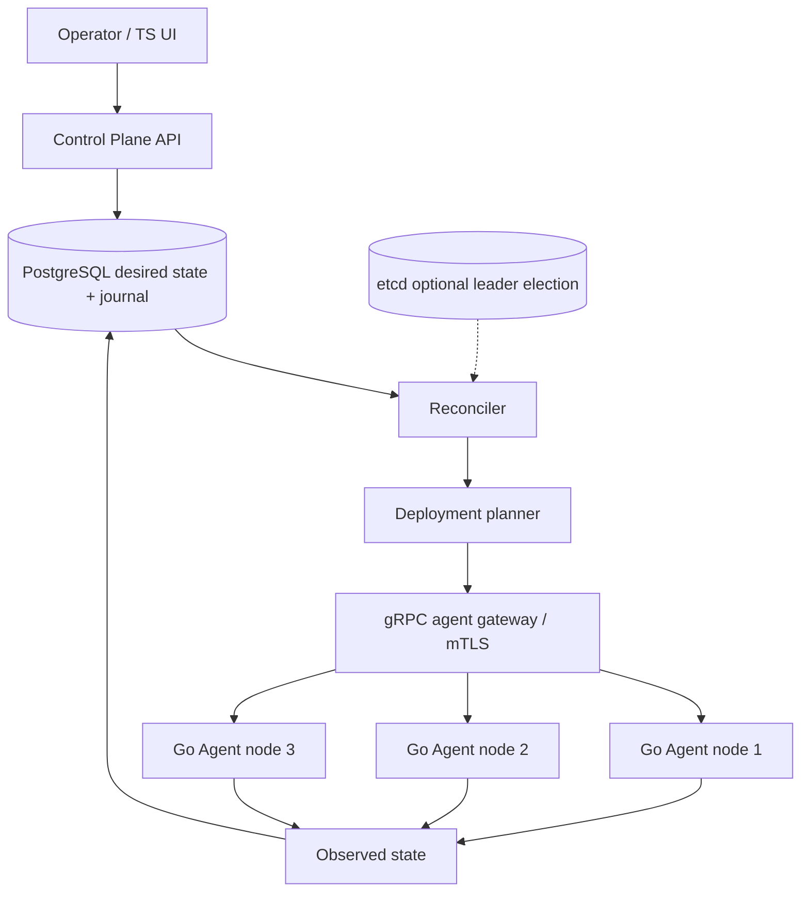

# Architecture — DIAO — Distributed Infrastructure Automation & Orchestration

> **Status:** proposed design for a learning project, NOT a description of existing code. After gate G2, update this document to reflect actual decisions rather than treating the initial proposal as immutable.
>
> Project **11/12** · estimated effort: **200–320 hours** · stack: **Go agent and control plane, gRPC+mTLS, PostgreSQL, optional etcd, TypeScript UI**.

## 1. Context, goals and scope

**Goal:** Build a control plane that manages declared desired state and safe application rollouts on remote agents, including recovery.

**Scope:** **MVP:** agents, node inventory, service manifests, reconciliation and one-app deployment. **Later:** rolling updates, rollback, RBAC, multi-node HA. **Out of scope:** full Kubernetes alternative, production-grade secrets manager.

### Skills developed

Accurate problem modeling, verifiable implementation, explicit management of constraints and evidence-based engineering decisions. This project's specific technical challenges are described in the following sections.

## 2. Technical context and data flow

**Boundaries:** Start with the smallest viable local architecture. Add processes and network hops only when explicitly justified by the requirements or the lesson objective.

### Components and responsibilities

- `control-api`: desired-state declarations, RBAC, audit log and optimistic concurrency.
- `planner`: rollout policy, dependency graph, placement constraints and dry-run.
- `reconciler`: idempotent desired-versus-observed loop with explicit state transitions.
- `agent`: local execution, health and process lifecycle without constant control-plane connectivity.
- `transport`: gRPC streaming/unary, node identity, mTLS and certificate rotation.
- `state`: PostgreSQL as desired-state authority; etcd only where HA coordination is justified.
- `release`: versioned artifacts, checksums and rollback strategy.

## 3. Domain and data model

`Node{id,identity,labels,observedVersion,health}`; `AppDefinition{name,artifactDigest,resources,healthPolicy}`; `Deployment{id,targetVersion,strategy,desiredGeneration,status}`; `AgentReport{nodeID,observedGeneration,services,status}`; `RolloutStep{deploymentID,nodeID,attempt,status}`. Artifacts use immutable digests, not mutable tags.

For each persistent entity, identify data ownership, source of truth, uniqueness rules, schema versioning and retention. If the MVP does not need a database, **do not add one for architectural decoration**.

## 4. Public contracts and interfaces

`POST /v1/deployments` with idempotency and expected generation; `GET /v1/deployments/{id}`; `POST /v1/deployments/{id}/abort`; gRPC `RegisterNode`, `ReportObserved`, `ApplyPlan`, `StreamEvents`. Agent commands include generation, idempotency key and authorization scope.

**Shared contract rules:** Validate inputs at boundaries; expose stable error categories; document retries and idempotency; never leak internal secrets or unauthorized data. Version externally consumed contracts.

## 5. Invariants and correctness conditions

- Agents reject arbitrary commands from untrusted senders; verify identities, manifests and permissions.
- Messages with older generations cannot overwrite newer desired state.
- `completed` means health criteria are met, not merely that a process started.
- Rollbacks target a previous **known immutable digest**, never an ambiguous mutable tag.
- Observed and desired states remain separate and divergence is measurable.
- Concurrent controllers cannot modify the same rollout without generation/lease coordination.

**Exercise:** encode these invariants as executable tests, database constraints or runtime assertions. Explain which can be guaranteed by a local transaction and which require cross-component coordination or an explicit failure model.

## 6. Concurrency, durability and failure scenarios

- Offline agent: desired state remains durable, deadlines and warnings are explicit.
- Control-plane crash: reconcile from persisted deployment steps.
- Partial rollout: pause, roll back or require manual intervention according to policy.
- Stale agent events: reject or tag using generation checks.
- Lost certificate: quarantine node and re-enroll safely; never bypass mTLS.

**Assumptions to validate explicitly:** whether failures are process-level or machine-level, trust in clocks, event ordering, duplicates, retry semantics and transaction boundaries. Do not assume synchronous networks or infallible dependencies.

## 7. Testing and measurement strategy

- Three-node simulation with desired/observed conflicts.
- Kill controller at every rollout boundary; restart without duplicate effects.
- Agent identity/signature, stale generation replay and RBAC negative tests.
- Upgrade/rollback while one node is disconnected.
- Observe convergence time, stalled rollouts and agent health.

Verification pyramid: fast unit tests → integration tests against real dependencies → model/property/fuzz tests where useful → fault injection and end-to-end scenarios. Keep *evidence* in `evidence/` or CI reports. Check LLM-proposed tests against requirements independently of the implementation.

## 8. Operations and security

- Emit structured logs, correlation IDs and actionable error context; exclude secrets and private data.
- For services, separate liveness (`/health/live`) from readiness (`/health/ready`) and avoid misleading health checks.
- Specify at least two useful service-level indicators where relevant (e.g., error rate, p95 latency, inconsistent states); do not promise SLOs without evidence.
- Enforce least privilege, external secret configuration, input-size limits and execution deadlines.
- Define backup and recovery procedures wherever persistent state exists; for a CLI, reproducibility and deterministic inputs may matter more.

## 9. Implementation plan — small, controlled increments

1. One controller, one agent, one service manifest.
2. Desired/observed reconciliation without HA.
3. Multiple agents, rollout strategy, recovery and RBAC.
4. mTLS, signed artifacts or integrity checks, auditing.
5. HA coordination only after single-controller tests pass.

After every increment: deliver a demonstration, test evidence, a trade-off list and a brief review with an LLM acting as a skeptical reviewer. Record a short ADR before adding a major dependency or infrastructure component.

## 10. Architecture decisions to defend

- Push versus pull desired state and offline behavior.
- PostgreSQL leadership lock versus etcd: when is the extra complexity justified?
- Custom executor versus Docker/Podman API; separate orchestration from runtime.
- Rollback versus roll-forward when a schema migration is involved.

For every decision, explain the context, at least two alternatives, rationale, operating costs, effect on the domain and how the choice could be reversed (see [`../../docs/ADR_TEMPLATE.md`](../../docs/ADR_TEMPLATE.md)).

## 11. Completion criteria and assessment

With three agents and a rolling upgrade interrupted mid-flight, safely halt or roll back according to policy; never run two uncontrolled active plans on the same generation.

**Additional requirement:** explain *what would fail if a safety mechanism were removed* (constraint, idempotency, fencing, event replay, etc.). Assessment uses [`../../docs/ASSESSMENT.md`](../../docs/ASSESSMENT.md): at least 20/24 overall and at least 3/4 in every dimension, supported by evidence.

## 12. Anti-patterns to identify in review

- Selecting a fashionable technology stack before identifying constraints and invariants.
- Circular tests that compare the implementation with itself.
- Hiding retries, duplicates and exceptions behind logging without resolving correctness.
- Undocumented assumptions that “this cannot happen in production.”
- Huge, unreviewable pull requests generated in one prompt.

**Related documents:** [`README.md`](README.md), [`AGENTS.md`](AGENTS.md), [`../../AGENTS.md`](../../AGENTS.md), [Skill index](../../.agents/skills/SKILLS.md).
