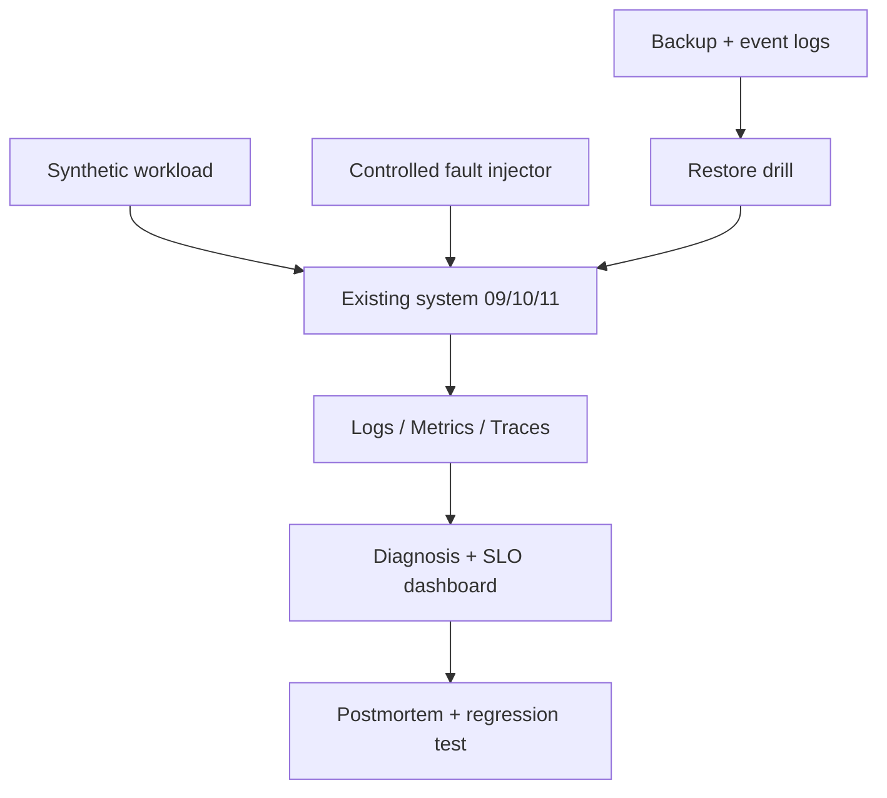

# Architecture — Production Engineering Challenge — final capstone

> **Status:** proposed design for a learning project, NOT a description of existing code. After gate G2, update this document to reflect actual decisions rather than treating the initial proposal as immutable.
>
> Project **12/12** · estimated effort: **100–160 hours** · stack: **Project 09, 10 or 11; OpenTelemetry, logs, metrics, load testing, backup and restore**.

## 1. Context, goals and scope

**Goal:** Demonstrate the ability to operate and recover an existing complex system under failures, without creating a twelfth new application.

**Scope:** **Scope:** isolated staging based on project 09–11, synthetic data, telemetry, backups and explicit reliability goals. **Out of scope:** destructive experiments on third-party or production infrastructure.

### Skills developed

Accurate problem modeling, verifiable implementation, explicit management of constraints and evidence-based engineering decisions. This project's specific technical challenges are described in the following sections.

## 2. Technical context and data flow

**Boundaries:** Start with the smallest viable local architecture. Add processes and network hops only when explicitly justified by the requirements or the lesson objective.

### Components and responsibilities

- `system-under-test`: existing project artifacts and configuration; do not simplify the domain for the exercise.
- `scenario-runner`: fault-injection scripts restricted to the isolated lab.
- `observability`: correlation IDs, structured logs, metrics and traces; justified SLI/SLO.
- `backup-restore`: runbooks, RPO/RTO and integrity verification of restored state.
- `evidence`: timeline, incident reports, postmortems and regression fixes.

## 3. Domain and data model

`Incident{id,start,impact,detectedAt,resolvedAt}`; `Experiment{hypothesis,blastRadius,abortConditions}`; `SLI{definition,window,threshold}`; `RecoveryEvidence{backupID,rpoObserved,rtoObserved,consistencyChecks}`. Specify units and definitions of each metric/state.

For each persistent entity, identify data ownership, source of truth, uniqueness rules, schema versioning and retention. If the MVP does not need a database, **do not add one for architectural decoration**.

## 4. Public contracts and interfaces

No new public API. Optional `run-scenario <scenario>` CLI only after safe preflight checks exist. Markdown/JSON reports; dashboards optional.

**Shared contract rules:** Validate inputs at boundaries; expose stable error categories; document retries and idempotency; never leak internal secrets or unauthorized data. Version externally consumed contracts.

## 5. Invariants and correctness conditions

- No fault-injection experiment may escape the dedicated lab; verify cluster identity, endpoints and data first.
- Recovery counts as successful only after domain invariants are verified, not just HTTP availability.
- Every experiment has abort criteria and an accountable decision owner.
- Each incident yields a regression test or preventive control.

**Exercise:** encode these invariants as executable tests, database constraints or runtime assertions. Explain which can be guaranteed by a local transaction and which require cross-component coordination or an explicit failure model.

## 6. Concurrency, durability and failure scenarios

Required scenarios: (1) lost DB/worker, (2) duplicates and out-of-order events, (3) overload and tail latency, (4) migration during rolling deployment, (5) attempted authorization bypass, (6) backup and restore. Optional: DNS failure, full disk, expired certificate, dependency degradation and network partition.

**Assumptions to validate explicitly:** whether failures are process-level or machine-level, trust in clocks, event ordering, duplicates, retry semantics and transaction boundaries. Do not assume synchronous networks or infallible dependencies.

## 7. Testing and measurement strategy

- When possible, scenarios are designed or run by a different author or mentor.
- Measure baseline versus repaired state: p50/p95/p99, error rate, throughput, CPU/RAM and SLI.
- Restore a randomly selected actual lab backup and replay available logs; validate ledger/order/generation invariants.
- Each drill ends with a blameless postmortem and preventive action plan.

Verification pyramid: fast unit tests → integration tests against real dependencies → model/property/fuzz tests where useful → fault injection and end-to-end scenarios. Keep *evidence* in `evidence/` or CI reports. Check LLM-proposed tests against requirements independently of the implementation.

## 8. Operations and security

- Emit structured logs, correlation IDs and actionable error context; exclude secrets and private data.
- For services, separate liveness (`/health/live`) from readiness (`/health/ready`) and avoid misleading health checks.
- Specify at least two useful service-level indicators where relevant (e.g., error rate, p95 latency, inconsistent states); do not promise SLOs without evidence.
- Enforce least privilege, external secret configuration, input-size limits and execution deadlines.
- Define backup and recovery procedures wherever persistent state exists; for a CLI, reproducibility and deterministic inputs may matter more.

## 9. Implementation plan — small, controlled increments

1. Define SLI/SLO, instrumentation, dashboard and backups.
2. Rehearse restore into a clean environment.
3. Run six controlled incidents and implement fixes.
4. Independent defense, limitations and roadmap.

After every increment: deliver a demonstration, test evidence, a trade-off list and a brief review with an LLM acting as a skeptical reviewer. Record a short ADR before adding a major dependency or infrastructure component.

## 10. Architecture decisions to defend

- What SLO is justified for this system, and what is its cost?
- Which degradation is acceptable and which demands stopping service?
- Which remediations should be automated versus operator-controlled?

For every decision, explain the context, at least two alternatives, rationale, operating costs, effect on the domain and how the choice could be reversed (see [`../../docs/ADR_TEMPLATE.md`](../../docs/ADR_TEMPLATE.md)).

## 11. Completion criteria and assessment

Documented SLI/SLO; six drills with hard evidence; successful recovery from a real lab backup; independent review and operational plan.

**Additional requirement:** explain *what would fail if a safety mechanism were removed* (constraint, idempotency, fencing, event replay, etc.). Assessment uses [`../../docs/ASSESSMENT.md`](../../docs/ASSESSMENT.md): at least 20/24 overall and at least 3/4 in every dimension, supported by evidence.

## 12. Anti-patterns to identify in review

- Selecting a fashionable technology stack before identifying constraints and invariants.
- Circular tests that compare the implementation with itself.
- Hiding retries, duplicates and exceptions behind logging without resolving correctness.
- Undocumented assumptions that “this cannot happen in production.”
- Huge, unreviewable pull requests generated in one prompt.

**Related documents:** [`README.md`](README.md), [`AGENTS.md`](AGENTS.md), [`../../AGENTS.md`](../../AGENTS.md), [`../../SKILLS.md`](../../SKILLS.md).
